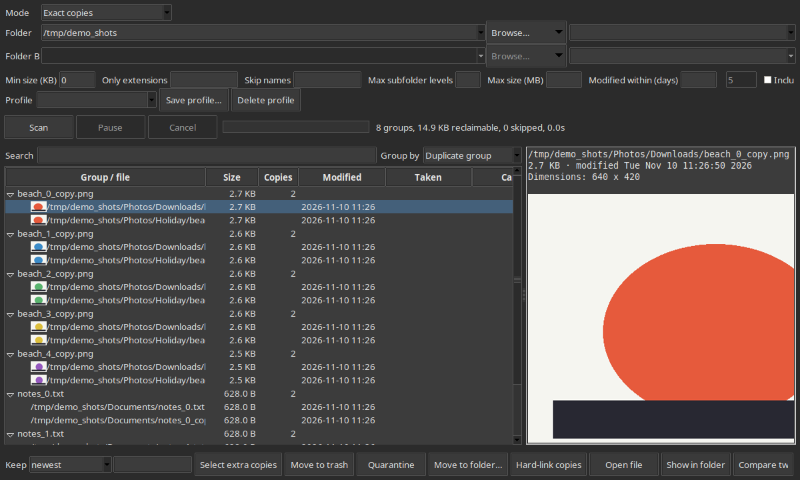
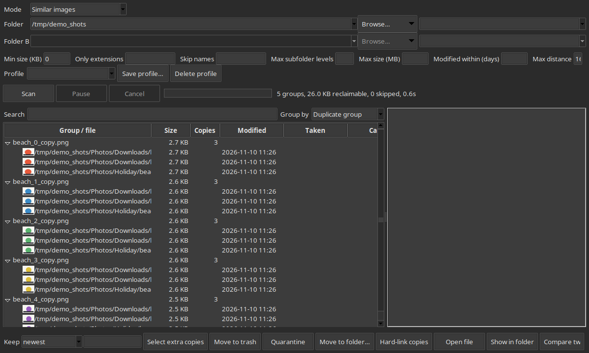

# Duplicate File Finder

Finds duplicate files on Linux. It can match exact copies, similar images, documents, videos
and audio, or compare two folders. A window shows the groups with a preview pane. A command-line
tool does the same work for scripts and schedules.

## Install

Debian and Ubuntu (including Linux Mint):

```bash
sudo apt install ./dupefinder_2.4.0_amd64.deb
```

The package installs two commands:

- `dupefinder` opens the window. Run it with a folder to start there: `dupefinder ~/Pictures`.
- `dupefinder-cli` is the command-line tool.

It also installs a Nemo right-click entry, "Find duplicates here", and recommends `ffmpeg`
for video previews and video similarity. Install `ffmpeg` if apt did not.

To run from source, use Python 3.12 with the packages in `requirements.txt`:

```bash
pip install -r requirements.txt
python3 gui.py
```

## Screenshots

The main window after a scan. Each group lists its copies, the preview pane shows the selected file, and the status line gives the totals. This screenshot uses a demo folder of synthetic files.



Similar images mode groups copies that were resized or recompressed. Images are only grouped when their colours also match, so the beaches below stay apart. The demo files are synthetic.



## Using the window

1. Pick a mode: exact copies, similar images, similar documents, similar videos, similar audio,
   or compare two folders.
2. Choose a folder with Browse or the drive list, then press Scan (Ctrl+Enter).
3. Select copies and use the buttons. Preview shows exactly what would change, without changing
   anything. Ctrl+K opens the command palette, which lists every action by name.

Copies are never removed without a confirmation. Each group always keeps one copy. RAW files are
left alone when their JPEG is in the same folder, unless you untick "Protect RAW pairs".

## Using the command line

```bash
dupefinder-cli ~/Downloads                         # list exact duplicates
dupefinder-cli ~/Music --mode audio --threshold 75  # similar audio
dupefinder-cli ~/Pictures --cleanup                 # dry run: what would be trashed
dupefinder-cli ~/Pictures --cleanup --apply         # really trash them (at most 500 copies)
dupefinder-cli ~/Pictures --hardlink-plan           # copies that could become hard links
dupefinder-cli ~/Pictures --live                    # rescan when files change; Ctrl+C stops
```

Useful options: `--keep-rule "prefer clean name"`, `--older-than 90`, `--larger-than-mb 100`,
`--exclude "*.tmp"`, `--skip-presets`, `--max-size-mb`, `--modified-within-days`, `--html FILE`,
`--webhook URL`, and `--mail-to ADDRESS --smtp-host HOST` to email the HTML report.

Full list: `dupefinder-cli --help`.

## Cleanup safety

- Cleanup is a dry run unless you add `--apply`.
- `--apply` refuses to trash more than `--max-files` copies (default 500). Nothing is changed when
  it refuses.
- Trashing goes through the desktop trash, so it can be restored from the Edit menu, or from the
  trash folder itself.
- Every trash, move and hard link is recorded in the history (Tools → History).

## Files the app keeps

| What | Where |
|---|---|
| Settings, profiles, custom actions | `~/.config/dupefinder/settings.json` (plain JSON, you can edit it) |
| Ignored groups | `~/.config/dupefinder/ignored.json` |
| Hash cache | `~/.cache/dupefinder/hashes-v2.db` (safe to delete) |
| History, undo and trash logs | `~/.local/state/dupefinder/` |
| Per-folder exclusions | a `.dupeignore` file in any folder, one glob per line, `#` for comments |

## Accuracy

Measured on real files from one machine, with labels built from the test variants (2.5.0):

| Mode | Precision | Recall | Test set |
|---|---|---|---|
| Exact copies | 100% | 100% | byte-identical copies |
| Similar images (default 16) | 100% | 98.5% | 48 photos, each resized, recompressed, cropped and rotated |
| Similar documents (default 70) | 96.7% | 98.3% | 59 real text files, each with about 2.5% of words changed |
| Similar videos (default 70) | 100% | 92.7% | 11 clips, each scaled, re-encoded and cropped |
| Similar audio (default 75) | 100% | 100% | 24 synthetic tunes, each as MP3 and AAC |

These are small test sets. Your files may score differently, so check a few groups in each mode before deleting anything.

## Limits

- Linux only. Windows and macOS builds are not provided.
- Similar-image and similar-video matching compares every pair, so very large folders are slow.
- Audio matching is tuned on synthetic and sample music. Check the threshold on your own files.
- The window does not support screen readers (it is built on Tk).
- The Flatpak and AppImage build scripts are in `packaging/`. Only the AppImage has been built.

## Tests

```bash
python3 -m unittest
```

GUI tests run only when a display is available. They are skipped otherwise.

## Building the packages

```bash
PYTHON=/path/to/python packaging/build_deb.sh      # needs PyInstaller in that Python
packaging/build_appimage.sh                         # needs APPIMAGETOOL set
packaging/build_flatpak.sh                          # needs flatpak-builder
```
